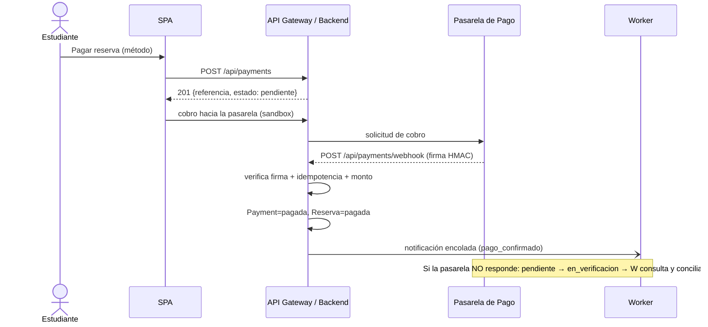

# Cambios del prototipo para que respalde el informe (y qué actualizar en el PDF)

Cada punto indica **qué se agregó al código** y **qué texto/diagrama del informe queda respaldado**.

## 1. Pagos con pasarela externa y webhook (RF-007, RF-008, UC-02)
**Código:** `models/Payment.js`, `utils/paymentService.js`, `utils/paymentGateway.js` (adaptador del procesador), `utils/card.js`, `utils/qr.js`, `utils/webhookSignature.js`, `utils/paymentState.js`, `controllers/paymentController.js`, `routes/paymentRoutes.js`; en el cliente `pages/Payments.jsx` (menú *Pagos*).

| UC-02 del informe | Dónde está en el código |
|---|---|
| 1-2. Selecciona la reserva pendiente y el método; el sistema redirige el cobro a la pasarela | `POST /api/payments` (crea el cobro `pendiente` con `referencia`; QR/efectivo devuelven el **QR real**) + `POST /api/payments/:referencia/card` (tarjeta) / `POST /api/payments/:referencia/report-qr` (QR informado) |
| 3. La pasarela envía una confirmación (webhook) | `POST /api/payments/webhook` — firma HMAC-SHA256 de `<timestamp>.<cuerpo>`, ventana anti-repetición de 5 min |
| 4. El sistema actualiza la reserva a "pagada" y registra el comprobante | `applyGatewayEvent()` → `Payment.estado = pagada`, `comprobante = CMP-AAAAMMDD-XXXXXX`, `Reservation.estadoPago = pagada` |
| 5. Notifica al estudiante | Se encola `pago_confirmado` en la cola de notificaciones |
| 3a. La pasarela rechaza | `status: failed` → pago `rechazada` con motivo; la reserva sigue `pendiente`; se puede reintentar |
| 3b. La pasarela no responde | `jobs/paymentReconciliation.js` (pagos con tarjeta): tras 30 s pasa a `en_verificacion` y el worker consulta al procesador y reintenta (hasta 10 veces) |

Propiedades defendibles: **idempotencia** (mismo `eventId` nunca se aplica dos veces; estado final inmutable), **validación de monto** (422 si no coincide), la API de la pasarela es un **adaptador** (`requestCharge`, `queryStatus`) reemplazable por una real.

Pruebas: `test/webhookSignature.test.js`, `test/paymentState.test.js`, `test/paymentService.test.js`.

Diagrama de secuencia sugerido (Mermaid) para el informe:

## 2. Cola persistente de notificaciones (patrón Outbox)
**Código:** `models/Notification.js`, `utils/notifications.js`, `jobs/notifications.js`. La API **solo encola** en MongoDB; el worker envía con reintentos y retroceso exponencial (30 s, 1, 2, 4… máx. 15 min; 5 intentos).
**Respalda:** "Desacoplamiento asíncrono" y el trade-off "reintento persistente en cola" (ahora es cierto para confirmación, cancelación, recordatorio y pagos; el OTP sigue siendo envío directo porque el usuario lo necesita al instante).

## 3. Worker como contenedor separable (C4 nivel 2)
**Código:** `worker.js`, `jobs/index.js`. Variable `WORKER_IN_PROCESS` (true = dentro del API; false = `npm run worker` como proceso aparte). Trabajos: notificaciones, recordatorios, conciliación de pagos, **reconciliación de cupos** (autorreparación).
**Actualizar el C4 nivel 2:** añadir la **Pasarela de Pago** como sistema externo con `Rel(gateway, pasarela, "Solicita cobros", "HTTPS")` y `Rel(pasarela, gateway, "Webhook firmado", "HTTPS/HMAC")`; `Rel(worker, pasarela, "Consulta estado de cobros", "HTTPS")`; en la BD agregar las colecciones `payments` y `notifications`; en el Worker indicar "proceso independiente o en proceso (configurable)".

## 4. Rate limit global en el Gateway
**Código:** `app.js` (límite global por IP, `RATE_LIMIT_MAX`, 1000/min por defecto) + el límite estricto de `/api/auth` (60 / 15 min). Ahora la frase "el Gateway aplica limitación de tasa a toda solicitud" es verdadera.

## 5. Reconciliación de cupos (respuesta a "¿y si el proceso cae entre descontar el cupo y crear la reserva?")
**Código:** `jobs/slotReconciliation.js`: cada 5 min compara `cuposDisponibles` con `cuposTotales − reservas no canceladas` y corrige con una actualización condicionada (CAS), solo en turnos sin actividad reciente. Agregar a **7.2 Trade-offs**: *"El descuento del cupo y la creación de la reserva son dos escrituras (sin transacción multi-documento para no exigir un replica set); la compensación cubre fallos controlados y un job de reconciliación repara los casos de caída del proceso."*

## 6. Evidencia de los escenarios de calidad
**Código:** `scripts/verify-scenarios.js` (`npm run verify:rnf`) y `test/gateway.http.test.js` (`npm test`).
- **ID-01:** 500 solicitudes concurrentes sobre un turno de 100 cupos → exactamente 100 reservas, 400 × 409, `cuposDisponibles = 0`, p50/p95/máx de `X-Response-Time`.
- **ID-02:** 401 sin token, 403 con rol estudiante, 401 en webhook sin firma, 429 en ráfaga de login.
- **ID-03:** la reserva responde 201 y la confirmación queda en la cola.

> **Antes de la defensa:** ejecuta `npm run verify:rnf`, y pega en el informe/diapositivas **tus números reales** (p95, duración). No uses cifras que no hayas medido.

## 7. Numeración de RF alineada con el informe
Los comentarios del código y los resúmenes de Swagger ahora usan la numeración del PDF: RF-003 reservar, RF-004 cupos en tiempo real, RF-005 menú, RF-006 proyección, RF-007/008 pagos, RF-009 notificación, RF-010 recordatorios, RF-011 dashboard/historial del estudiante, RF-012 cancelar, RF-013 asistencia, RF-014 configuración y reportes.

## 8. Paleta del informe
`client/tailwind.config.js`, `index.css`, correos y reportes usan ahora la paleta de la sección 2.3.1 (`#1B365D`, `#E5A823`, `#5C6B7A`, `#F5F7FA`, `#2E7D46`, `#C0392B`, `#D98E04`, `#2E6BA8`).

---

## Texto listo para reemplazar en el PDF

**Escenario [ID-02] (págs. 14-15, estaba corrupto):**
- *Fuente:* Usuario externo no autorizado o estudiante autenticado que intenta escalar privilegios o realizar fuerza bruta sobre el acceso.
- *Estímulo:* Envío masivo de intentos de inicio de sesión o invocación directa de rutas administrativas (PUT /api/shifts/config, POST /api/menus) sin token válido o con rol estudiante.
- *Entorno:* Operación normal en red abierta.
- *Artefacto:* Pipeline de seguridad del API Gateway: express-rate-limit (límite global y límite estricto en /api/auth) → authMiddleware (JWT) → roleMiddleware (RBAC), más verificación OTP con HMAC-SHA256.
- *Respuesta:* El limitador bloquea ráfagas superiores a 60 peticiones cada 15 minutos en /api/auth (HTTP 429); los intentos de OTP se invalidan tras 5 fallos o 5 minutos; la cadena rechaza tokens ausentes o expirados (HTTP 401) y roles no autorizados (HTTP 403) antes de tocar la lógica de negocio.
- *Medida:* 100 % de accesos no autorizados rechazados en la capa perimetral, sin exposición de datos sensibles ni ejecución de escrituras (verificado con `npm run verify:rnf` y `npm test`).

**Sección 7.2, fila "Desacoplamiento asíncrono" (corregida):** *"Beneficio: la API no espera al SMTP y no requiere un broker externo. Trade-off: la cola vive en MongoDB (outbox) y la consume un worker por sondeo cada 5 s, por lo que un correo puede llegar con unos segundos de retraso; ante fallos del SMTP se reintenta con retroceso exponencial (máx. 5 intentos) y, si se agotan, queda marcado como `fallida` para revisión."*

**Fragmento 4 (worker de recordatorios):** reemplazar por `server/jobs/reminders.js` actual: el recordatorio se **encola con clave única** `recordatorio:<id>` (idempotente entre instancias) y luego se marca `recordatorioEnviado`; el envío lo hace el worker de notificaciones.

**Fragmento 3 (reserva):** ahora además guarda `monto` y, en lugar de enviar el correo, hace `enqueue('confirmacion', req.user, reserva)`.

**Sección 7.1:** cambiar "totalidad de RF-001 a RF-014" solo si presentas la demo de pagos (Estudiante → *Pagos*). Los pagos con QR y efectivo se validan en **Caja** por el personal; la tarjeta usa un procesador interno adaptable: para cobrar dinero real hay que implementar `requestCharge`/`queryStatus` de un proveedor en `utils/paymentGateway.js`.

## Límites que conviene declarar (honestidad técnica en la defensa)
- El **procesador de tarjetas es interno** (valida y simula la respuesta según el final de la tarjeta); no mueve dinero real hasta conectar un proveedor. El QR no es un QR interbancario: contiene la referencia y el monto y lo valida el personal de **Caja**.
- Los reembolsos de reservas pagadas y luego canceladas son manuales (la API responde `reembolsoPendiente: true`).
- JWT en `localStorage` y *polling* de 30 s (ya documentados como trade-offs).
- No hay transacciones multi-documento (requieren replica set); se compensa con reconciliación.

## 9. Menú del día desplegable (RF-003 / consulta de menú)
**Código:** `client/src/components/DailyMenu.jsx` + `StudentHome.jsx`. El estudiante ve la tarjeta destacada del almuerzo y, debajo, la sección **Menú de Hoy** con un desplegable por turno (desayuno, almuerzo y cena) que muestra plato, descripción, horario, calorías e imagen. Usa `GET /api/menus?fecha=` (los tres turnos en una sola consulta).

## 10. Métodos de pago reales y pantalla de Caja
- **QR real** (`qrcode`): imagen PNG escaneable con `SIRECOM|PAGO|<referencia>|<monto>|BOB`. El estudiante informa el pago y **Caja** lo valida (`POST /api/payments/:id/confirm | reject`, roles Cocina/Admin).
- **Efectivo:** comprobante con QR/referencia; **Caja** confirma el cobro (`/cocina/caja`).
- **Tarjeta:** validación Luhn/vencimiento/CVV; número y CVV nunca se guardan (solo marca + últimos 4); resultado por webhook firmado.
- Diagrama a actualizar en el informe: UC-02 con tres variantes (QR → verificación en caja; efectivo → caja; tarjeta → procesador + webhook). Actor adicional: **Personal de Caja** (Cocina Central/Admin).
- Pruebas: `test/card.test.js`, `test/paymentService.test.js` (confirmación/rechazo en caja, doble confirmación, tarjeta no validable manualmente).

## 11. Imágenes de los platos
`client/public/menu/<turno>-<1..5>.svg` (15 ilustraciones originales, una por plato del seed). `seed.js` las asigna con `imagenUrl: /menu/<turno>-<n>.svg`; `MenuImage.jsx` usa una imagen por defecto del turno/día si el menú no trae imagen o la URL falla. El editor de menú acepta URL externas o rutas `/menu/...`. Para ver las imágenes en una base ya sembrada: `npm run seed` (actualiza los menús existentes).
